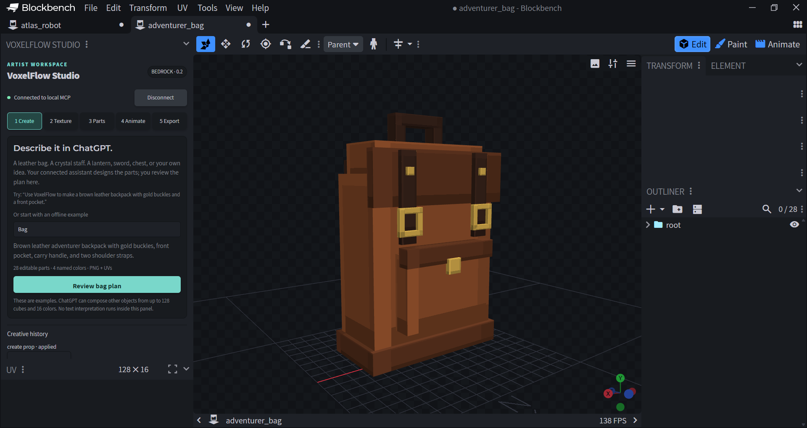
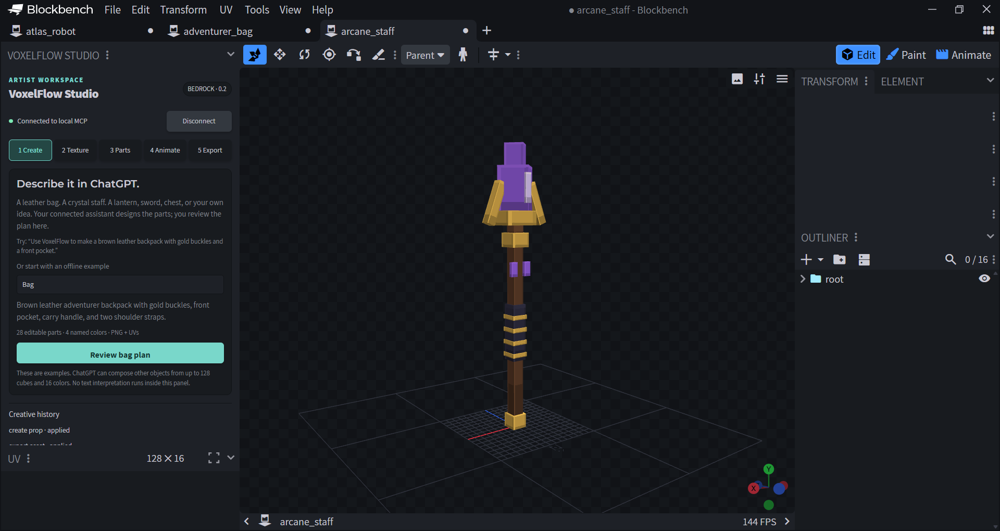

# VoxelFlow Studio

**Turn prompts into editable Minecraft-style models.**

[](https://github.com/KumarManuSaraswat/voxelflow-studio/actions/workflows/check.yml)
[](LICENSE)
[](docs/distribution.md)

Describe a leather bag, a crystal staff, or your own cube-based object in a connected ChatGPT/Codex desktop chat. VoxelFlow brings the design into Blockbench with editable parts, a pixel texture, and export checks. Keep creating with prompts or finish the details by hand.

[Website](https://voxelflow-studio.vercel.app/) · [Interactive setup guide](https://voxelflow-studio.vercel.app/guide.html) · [Install the beta](#install) · [Examples](examples/props/) · [Contribute](CONTRIBUTING.md) · [Roadmap](docs/roadmap.md)



## From an idea to a model

**Try it without an AI account:** load the Blockbench plugin and choose the Bag, Staff, or Robot example in the Create panel. For chat-driven creation, use a supported local desktop host. [Prompt gallery](plugins/voxelflow-studio/PROMPTS.md) · [Installation help](SUPPORT.md) · [Starter contributions](docs/contributor-tasks.md)

> Create a brown leather backpack with gold buckles, shoulder straps, and a front pocket.

1. **Describe it in chat.** The assistant designs the parts and materials through VoxelFlow's MCP tools.
2. **Review it in Blockbench.** Approve the proposed change, inspect the model, and adjust it with native editing and Undo.
3. **Export the result.** Save the editable `.bbmodel` and checked Bedrock resource assets.

The prompt belongs in your AI chat; Blockbench is the model workspace. Bag, Staff, and Robot examples also work locally without an AI account.

## What works today

| Capability | Desktop beta 0.3.4 |
| --- | --- |
| General props | Up to 128 cubes, 16 named materials, and 32 groups, with rotations and pivots |
| Texturing | PNG atlas, per-face UVs, native painting, and named recoloring that preserves painted pixels |
| Characters | Configurable Atlas robot, mapping of suitable existing humanoid rigs, editable idle/walk/attack clips |
| Artist control | Native approval dialogs, Undo, stale-proposal checks, and retry deduplication |
| Export | Editable Blockbench source and Bedrock geometry, textures, and applicable animation resources |
| Desktop integration | Bundled MCP server, 14 tools, 2 prompts, setup/modeling skills, and a Windows companion launcher |

This is an early desktop beta. Structural changes through MCP currently create a new model tab. Custom animated creatures, inventory items, wearable attachments, and gameplay behavior are future work. Resource exports still need Minecraft integration and in-game testing. See [supported scope](docs/roadmap.md) and [Bedrock integration](docs/bedrock-integration.md).

## Install

Requires **Node.js 22+**, **Blockbench desktop 5.2+**, and a desktop ChatGPT/Codex host supporting local plugins. Windows is tested; macOS/Linux are not yet verified.

**[Download the desktop beta ZIP](https://github.com/KumarManuSaraswat/voxelflow-studio/releases/download/v0.3.4/voxelflow-desktop-beta-0.3.4.zip)** · [Release notes](https://github.com/KumarManuSaraswat/voxelflow-studio/releases/tag/v0.3.4) · [Full installation guide](plugins/voxelflow-studio/INSTALL.md)

1. Extract the ZIP. Load its `plugins/voxelflow-studio/blockbench/voxelflow_studio.js` in Blockbench using **File → Plugins → Load Plugin from File**.
2. Double-click `plugins/voxelflow-studio/Start VoxelFlow.cmd` and keep the companion running.
3. In Blockbench, open **Tools → VoxelFlow Studio → Connect** and confirm the automatically filled local connection.
4. Open the extracted folder as a local project in your supported desktop host and install **VoxelFlow Studio** from the **VoxelFlow desktop beta** source. Start a fresh local chat.

There is no `npm install` or build step for the desktop download. Codex CLI users can instead register the source directly:

```text
codex plugin marketplace add KumarManuSaraswat/voxelflow-studio
codex plugin add voxelflow-studio@voxelflow-desktop-beta
```

The Blockbench plugin and local companion are still required. See the [install guide](plugins/voxelflow-studio/INSTALL.md) for those steps, other operating systems, pairing, and uninstalling.

**GitHub availability does not mean public ChatGPT directory availability.** This release is installed locally. Public directory submission and account-level ChatGPT testing remain outstanding; the desktop-only submission route currently requires approved-partner eligibility. See [distribution status](docs/distribution.md).

## Examples and verification

Open the editable [adventurer bag](examples/props/bag/adventurer_bag.bbmodel), [arcane staff](examples/props/staff/arcane_staff.bbmodel), or [Atlas robot](examples/robot/atlas_robot.bbmodel) in Blockbench. Specifications, textures, and validation reports are included alongside them.



The beta was checked on **Windows, Blockbench 5.2.2, and Node 24.11.1**, with **84 automated tests** for that live-tested baseline. A real Codex CLI prompt designed a [20-cube lantern](examples/props/lantern/brass_festival_lantern.bbmodel), created after native approval and exported successfully. A fresh desktop extraction works without `node_modules`. Minecraft runtime behavior and ChatGPT account onboarding remain unverified. [Read the evidence](docs/verification.md).

Version 0.3.4 passes **102 automated tests** and fresh-extraction package checks. Its repeated-part and compact-inspection additions have not yet had a new live Blockbench UI run.

## Develop

Version 0.3.4 adds [token-efficient modeling](docs/token-efficient-modeling.md): locally expanded repeated parts and compact inspection, with full geometry still available on demand.

```sh
git clone https://github.com/KumarManuSaraswat/voxelflow-studio.git
cd voxelflow-studio
npm ci
npm run check
```

Load `dist/voxelflow_studio.js` in Blockbench. Run `npm run bridge`, then connect from the VoxelFlow panel using the port and session token in that terminal. Keep connection credentials private.

| Command | Purpose |
| --- | --- |
| `npm run check` | Type checking, tests, build, and reproducible examples |
| `npm run demo -- --prop bag` | Exercise the real MCP/editor path; requires native approvals |
| `npm run package:desktop` | Build both standalone desktop ZIPs |
| `npm run verify:desktop` | Check a fresh extraction and bundled MCP startup |
| `npm run doctor` | Read-only local package, MCP discovery, and editor preflight |
| `npm run measure:payloads` | Compare explicit/compact JSON sizes; these are not billing estimates |
| `npm run package` | Package the source, builds, examples, and community docs |

[Architecture](docs/architecture.md) · [MCP setup](docs/mcp-integration.md) · [Prompt workflow](docs/prompt-to-model.md) · [Manual checks](docs/manual-smoke-test.md) · [Support](SUPPORT.md)


## Build with us

VoxelFlow is an MIT-licensed community project, initially maintained by [@KumarManuSaraswat](https://github.com/KumarManuSaraswat). Artists, developers, documentation writers, and testers are welcome. Useful starting points include prompt/model examples, platform testing, clearer onboarding, and the next modeling tools on the [roadmap](docs/roadmap.md).

Read [Contributing](CONTRIBUTING.md) before a pull request. Our [governance](GOVERNANCE.md) describes how contributors can become maintainers and how the project can move into a dedicated organization as it grows. Community participation follows the [Code of Conduct](CODE_OF_CONDUCT.md); vulnerability reports follow the [security policy](SECURITY.md).

## Support development

[Sponsor VoxelFlow's maintainer on GitHub](https://github.com/sponsors/KumarManuSaraswat) to help fund maintenance, clearer installation, compatibility testing, better model editing, Minecraft export improvements, and contributor documentation.

VoxelFlow remains MIT licensed. Sponsorship supports the maintainer's work; it does not purchase a feature, deadline, or support guarantee. Proposed priorities are tracked in the [roadmap](docs/roadmap.md), with progress in issues and releases.

## License and acknowledgments

Original project code is [MIT licensed](LICENSE). Bundled dependencies retain their [license notices](plugins/voxelflow-studio/THIRD_PARTY_NOTICES.txt); development dependency information is in [THIRD_PARTY_NOTICES.txt](THIRD_PARTY_NOTICES.txt).

Built on Blockbench and the Model Context Protocol. VoxelFlow Studio is an independent project and is not affiliated with or endorsed by Mojang, Microsoft, OpenAI, or Blockbench's maintainers.
